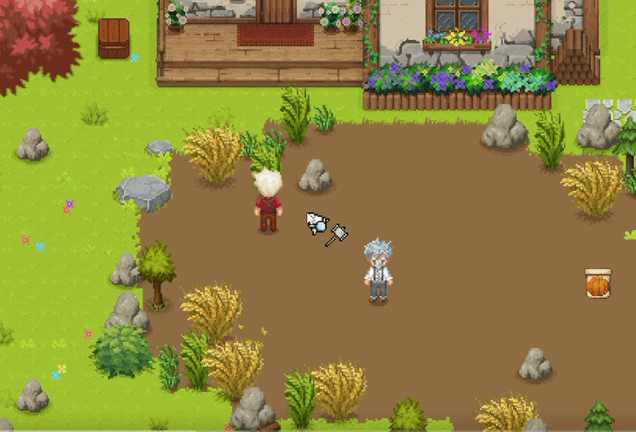
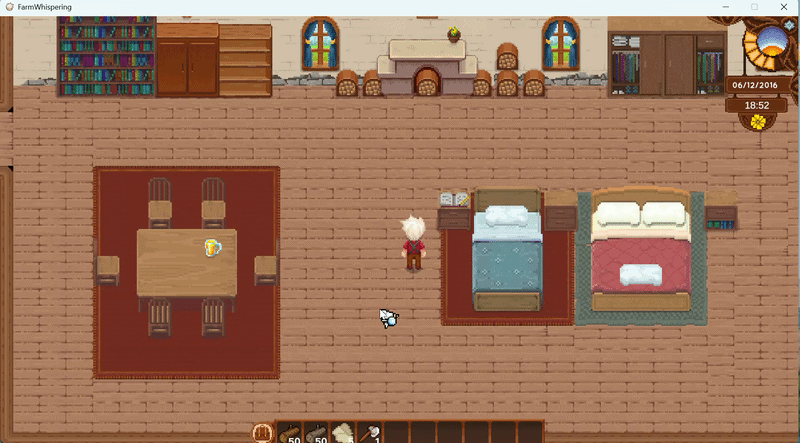

# 麦田物语（FarmWhispering）

一个基于 Unity 开发的 2D 农场 RPG Demo，聚焦于**种植收割、建造互动、NPC 行为与任务流程**等核心玩法的实现。

## 项目简介

本项目用于演示一个完整可游玩的 2D 农场游戏基础框架，包含角色移动、场景交互、作物系统、建造系统、背包交易、任务系统等常见模块，适合作为学习 Unity 游戏开发的实战参考。

## 功能演示

### 作物系统与收割

### 建造系统

## 主要功能

- 作物种植、生长与收割流程
- 建造与场景交互系统
- 背包与物品管理
- 任务触发、追踪与完成
- 基于状态机（FSM）的角色/NPC 行为控制
- 路径规划与移动逻辑优化（A* / 分层寻路思路）
- 对象池等性能优化方案

## 开发环境

- Unity（建议使用项目原始版本打开）
- C#

## 快速开始

1. 使用 Unity Hub 打开本项目根目录。
2. 等待依赖导入完成后，打开主场景。
3. 点击 `Play` 运行，体验种植、建造与交互流程。

## 目录说明（节选）

- `Scripts/`：核心游戏逻辑脚本与功能模块
- `作物系统&收割.gif`：作物玩法演示动图
- `建造.gif`：建造玩法演示动图

## 说明

本项目为 Demo 性质，后续可在此基础上继续扩展：

- 更多作物与季节系统
- 更丰富的 NPC 日程与对话
- 建筑升级与经济系统
- 存档与读档机制